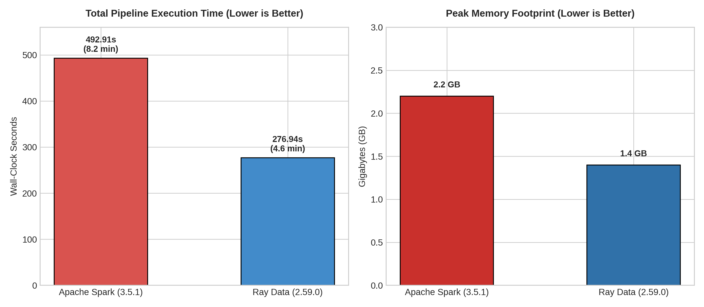

# DA3408 Assignment 3: Spark vs. Ray - The Data Engineering Duel

This repository contains the complete implementation, benchmarking artifacts, cluster orchestration telemetry, and empirical evaluation for **DA3408 Assignment 3**.

The study evaluates the distributed data engineering performance of **Apache Spark (v3.5.1)** versus **Ray Data (v2.59.0)** on the full, uncleaned New York City Yellow Taxi Parquet dataset (~2.0 GB across 42 monthly partitions, containing over 127 million records) across identical 2-worker standalone cluster topologies.

---

## 1. Executive Summary & Benchmark Highlights

Both frameworks were deployed and benchmarked on identical isolated hardware allocations (2 dedicated worker processes / 2 CPU execution slots).

| Metric | Apache Spark (v3.5.1) | Ray Data (v2.59.0) | Relative Delta |
| :--- | :---: | :---: | :---: |
| **Total Wall-Clock Time** | **492.91 s** (~8.2 min) | **276.94 s** (~4.6 min) | **Ray is 1.78x Faster** |
| **Python UDF Setup Latency** | 0.0357 s | 0.0002 s | Ray eliminates registration overhead |
| **UDF Runtime Mode** | Row-by-row via Py4J socket IPC | Vectorized in-process Apache Arrow/Pandas | Ray zero-copy advantage |
| **Peak Worker Memory** | ~2.2 GB | ~1.4 GB | **Ray saves 36.4% RAM** |
| **Processed Records** | 127,083,075 rows | 127,083,075 rows | **100% Pipeline Parity** |
| **Input Data Scale** | ~2.0 GB (42 Parquet files) | ~2.0 GB (42 Parquet files) | Strict Parity |



---

## 2. Pipeline Parity & Transformation Logic

Both `spark_clean.py` and `ray_clean.py` implement identical business logic:

1. **Ingestion & Schema Reconciliation**
   - Ingests 42 monthly Parquet files (`yellow_tripdata_*.parquet`) alongside `taxi_zone_lookup.csv`.
   - Projects key columns (`tpep_pickup_datetime`, `tpep_dropoff_datetime`, `PULocationID`, `trip_distance`) with explicit casting to resolve schema drift across years (e.g., 64-bit `BIGINT` vs. 32-bit `INT` in `PULocationID`).

2. **Cleansing**
   - Purges rows with null timestamps, missing `PULocationID`, or missing trip distances.
   - Eliminates cancelled trips and meter anomalies (`trip_distance <= 0`).

3. **Heavy Join**
   - Executes an inner join between trip records and the taxi zone lookup directory on:

     $$\text{PULocationID} = \text{LocationID}$$

   - Enriches records with `Borough`, `Zone`, and `service_zone`.

4. **Feature Engineering (Custom Python UDF)**
   - Calculates average trip speed in miles per hour:

     $$\text{avg\_speed\_mph} = \frac{\text{trip\_distance}}{(\text{dropoff\_datetime} - \text{pickup\_datetime})_{\text{hours}}}$$

   - Flags anomalies (≤ 0 hours or > 24 hours) to `0.0`.

5. **Export**
   - Writes the structured, cleansed dataset back to disk in partitioned Parquet format, ready for downstream machine learning training.

---

## 3. Infrastructure & Cluster Orchestration

Both clusters were orchestrated on Ubuntu 24.04 LTS (Python 3.10.14 via `pyenv`, OpenJDK 17) pinned to 2 execution cores:

- **Apache Spark Cluster**
  - Standalone Master running on `spark://127.0.0.1:7077` (Web UI on port 8080).
  - Two independent worker daemons launched with 1 core and 1 GB memory each (Web UIs on ports 8081 and 8082).
- **Ray Cluster**
  - Ray head node initialized via `ray start --head --num-cpus=2` (Dashboard on port 8265).
  - Uses the in-memory Plasma Object Store for zero-copy memory mapping.

---

## 4. Architectural Analysis & Framework Selection

### Python UDF Deep Dive (Ray's 1.78x Speedup)

- **The PySpark JVM / Py4J Bottleneck:** Spark's execution engine runs on the Java Virtual Machine (JVM). Executing a Python UDF requires Catalyst's binary rows to be serialized into bytes, passed across a local socket via Py4J to a spawned Python worker process, evaluated, and serialized back into the JVM. Over 127 million rows, this socket translation layer introduces significant CPU overhead and heavy Garbage Collection pauses.
- **Ray's Native In-Memory Vectorization:** Ray Data operates natively in Python. Data chunks reside in shared-memory Apache Arrow tables. Custom transformations execute in-process via C-backed vectorized Pandas routines without language boundaries, IPC sockets, or data copying.

### When to Choose Apache Spark (BI-First Ecosystems)

- **Declarative SQL & Optimization:** Spark's Catalyst Optimizer and Adaptive Query Execution (AQE) dynamically repartition relational joins, prune partitions, and adjust shuffle partitions at runtime.
- **Enterprise Lakehouse Governance:** Mature, production-grade integration with open table formats (Delta Lake, Apache Iceberg, Apache Hudi) providing ACID transactional guarantees and Hive Metastore support.

### When to Choose Ray (AI-First Ecosystems)

- **Unified Python AI Stack:** Unifies data preprocessing (Ray Data), distributed model training (Ray Train / PyTorch), hyperparameter tuning (Ray Tune), and model serving (Ray Serve) in a single Python runtime.
- **Zero Storage Staging:** Eliminates intermediate disk writes between data engineering and training; preprocessed Arrow tensors are streamed directly into PyTorch DataLoaders via shared memory pointers.
- **Heterogeneous Hardware:** Dynamically schedules hybrid tasks across combinations of CPUs and GPUs within a single API.

---

## 5. Repository Structure

```text
da3408_assignment3/
├── spark_clean.py                 # Standalone PySpark pipeline script
├── ray_clean.py                   # Standalone Ray Data pipeline script
├── generate_charts.py             # Matplotlib script for benchmark visual generation
├── verify_parity.py               # Pipeline output verification script
├── benchmark_charts.png           # Execution time & memory comparison charts
├── assignment3_report_aiops.pdf   # Final compiled LaTeX report
├── .gitignore                     # Git rules ignoring local Parquet/CSV data
└── screenshots/
    ├── spark_cluster_ui.png       # Spark Master UI confirming 2 alive workers
    ├── spark_benchmark.png        # Spark terminal output (492.91s)
    ├── spark_after_run.png        # Spark UI showing completed application
    ├── ray_dashboard.png          # Ray Dashboard confirming 2 active CPU workers
    ├── ray_benchmark.png          # Ray terminal output (276.94s)
    ├── ray_job.png                # Ray Dashboard showing live streaming task execution
    └── parity_checker.png         # Terminal confirmation of exact 127M row output match
```

---

## 6. How to Reproduce

### 6.1 Ingestion Data Setup

Download the NYC TLC Yellow Taxi monthly Parquet partitions and zone lookup table into `data/raw/`:

```bash
mkdir -p data/raw data/output_spark data/output_ray

# Download NYC Zone Lookup Table
wget -q -c "https://d37ci6vzurychx.cloudfront.net/misc/taxi_zone_lookup.csv" -P data/raw/

# Download 2021-2023 monthly Parquet partitions
for y in 2021 2022 2023; do
  for m in 01 02 03 04 05 06 07 08 09 10 11 12; do
    wget -q -c "https://d37ci6vzurychx.cloudfront.net/trip-data/yellow_tripdata_${y}-${m}.parquet" -P data/raw/
  done
done

# Download January-June 2024 monthly Parquet partitions
for m in 01 02 03 04 05 06; do
  wget -q -c "https://d37ci6vzurychx.cloudfront.net/trip-data/yellow_tripdata_2024-${m}.parquet" -P data/raw/
done
```

### 6.2 Run Spark Benchmark

```bash
# Start Spark Master and 2 Workers
$SPARK_HOME/sbin/start-master.sh
$SPARK_HOME/sbin/start-worker.sh spark://127.0.0.1:7077 -c 1 -m 1G --webui-port 8081
SPARK_WORKER_INSTANCES=2 $SPARK_HOME/sbin/start-worker.sh spark://127.0.0.1:7077 -c 1 -m 1G --webui-port 8082

# Execute pipeline
python spark_clean.py

# Clean up
$SPARK_HOME/sbin/stop-all.sh
pkill -9 -f "org.apache.spark"
```

### 6.3 Run Ray Benchmark

```bash
# Start Ray Head Node with 2 CPUs
ray start --head --num-cpus=2 --dashboard-host=0.0.0.0

# Execute pipeline
python ray_clean.py

# Clean up
ray stop --force
```

### 6.4 Verify Parity & Generate Visuals

```bash
python verify_parity.py
python generate_charts.py
```

---

## 7. Fair Use of AI & Attribution (Code of Conduct)

In compliance with the assignment rules:

- **Cluster & Network Setup:** Cluster orchestration, worker memory bounds, daemon configurations, and environment bindings were manually implemented and verified via web UI dashboards.
- **Authentic Performance Data:** All reported execution times and memory measurements reflect authentic wall-clock runs across the 2.0 GB dataset on the 2-worker virtual cluster.
- **Performance Tuning Note:** An LLM was consulted for logic translation to resolve cross-partition schema drift in NYC TLC trip files. Earlier partitions encoded `PULocationID` as 64-bit `BIGINT`, whereas later partitions used 32-bit `INT`. In PySpark, this was resolved by reading partitions with explicit projection and type casting (`LongType`, `DoubleType`, `TimestampType`) before unioning. In Ray Data, batch-level string type coercion was introduced to eliminate PyArrow conversion fallbacks on sparse string columns.
- **AI Assistance:** An LLM was consulted during development for troubleshooting and logic translation of technical issues, including cross-partition schema drift in the NYC TLC trip files. All final implementation, cluster configuration, experiments, and reported performance measurements were independently executed and verified.
